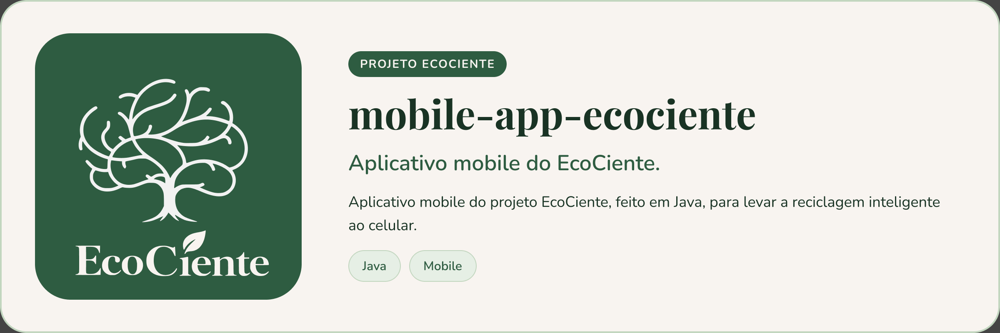

<p align="center">
  
</p>

# mobile-app-ecociente


Repositório do aplicativo mobile do projeto EcoCiente

## Área do síndico

O síndico entra pelo mesmo login dos outros perfis. O perfil vem da API (`/api/usuarios/me`) e leva o usuário para a `SindicoHomeActivity`. As telas usam dados reais das APIs do projeto:

- **Dashboard e ranking:** indicadores do condomínio (`/api/condominios/{id}/dashboard`) e ranking por torre e por morador (ds-pontuacao-api).
- **Descartes:** os descartes dos moradores que esperam decisão são aprovados ou reprovados pelo síndico.
- **Coletas:** a lista de cooperativas da cidade do condomínio (ordenável por distância pelo GPS), o pedido de coleta, o histórico e a avaliação de coletas realizadas (ds-calendario-api e ds-mobile-api).
- **Mensagens:** conversas com as cooperativas (`/api/conversas`).
- **Condomínio:** nome, endereço, torres e foto, vindos do perfil e salvos de volta na API.

Ainda não há API de avisos. O formulário de aviso valida título e mensagem e guarda apenas um rascunho no aparelho: ele não envia avisos aos moradores nem grava no servidor, e a lista de avisos começa vazia.

## Instalando

```bash
git clone https://github.com/EcoCiente-Instituto-J-F/mobile-app-ecociente.git
cd mobile-app-ecociente
```

Pré-requisitos: Android Studio (compileSdk 36, minSdk 24) e JDK 17. O build exige `FACEBOOK_APP_ID`, `FACEBOOK_LOGIN_PROTOCOL_SCHEME` e `FACEBOOK_CLIENT_TOKEN`, lidas de variáveis de ambiente ou de um `.env` na raiz. O `.env.example` da raiz documenta tanto as variáveis do build Android quanto as do **backend** (`backend/`).

## Usando

Abra a pasta no Android Studio e execute o módulo `app`, ou compile pela linha de comando:

```bash
./gradlew assembleDebug      # Windows: .\gradlew.bat assembleDebug
```

## Testes

O CI executa testes unitários, lint e build:

```bash
./gradlew testDebugUnitTest
./gradlew lintDebug
./gradlew assembleDebug
```

## Estrutura do projeto

```
.
├── app/                   # aplicativo Android (Java, MVVM)
│   └── src/main/java/com/example/ecociente/
│       ├── model/  repository/  viewmodels/  views/  ui/  notifications/  midias/  util/
├── backend/               # funções serverless (Node.js 24) para a Vercel
│   ├── api/               # notificacaoMotivacional.js
│   └── lib/               # firebaseAdmin.js, postgres.js
├── docs/padroes-mobile.md # padrões do app
├── PADROES.md             # resumo dos padrões
├── firestore.rules        # regras do Firestore
├── k8s/                   # job de build do app
├── Dockerfile
└── scripts/pr-bot/        # geração automática da descrição de PR
```

### Pacotes do app

O app segue MVVM: a tela (`views`) mostra o estado que o `viewmodels` expõe, e o ViewModel busca e grava os dados pelo `repository`. As dependências vão sempre nesse sentido: nenhum ViewModel ou repositório conhece uma tela.

| Pacote | O que guarda | Função |
|---|---|---|
| `model` | Classes de dados: `PerfilUsuario`, `Aviso`, `Conversa`, `PreferenciasNotificacao`, os `Resultado*` | Representam o que o app manipula, com regras simples (por exemplo, `PerfilAcesso` decide a home de cada perfil). Não conhecem a interface. |
| `repository` | Acesso a dados: Firebase (`PerfilRepository`, `LoginRepository`), APIs HTTP (`ApiAutenticada` e os `*Repository`), armazenamento local (`FavoritosRepository`, `LembretesColeta`, `CredenciaisSeguras`) | Único lugar que fala com rede e armazenamento. A rede roda fora da thread principal e o resultado volta na principal. Os `*Json` só leem e montam JSON, o que permite testá-los sem Android. |
| `viewmodels` | Um ViewModel por fluxo (`LoginViewModel`, `ChatViewModel`, `SolicitacoesViewModel`...) | Guardam o estado da tela em `LiveData`, chamam os repositórios e sobrevivem à rotação. Não referenciam views. |
| `views` | As telas (Activities e Fragments) e os adapters que só existem para uma tela | Ligam o layout XML ao ViewModel, tratam cliques e mostram carregamento, sucesso e erro. |
| `ui` | Componentes e utilitários reutilizáveis: `BarraNavegacaoView`, `CalendarioMensalView`, `DialogoEco`, `AvisoFlutuante`, os gráficos do dashboard e o confete do quiz, `Navegacao`, `Motion`, `MascaraTexto` | Peças visuais e funções de interface, para não repetir código. |
| `util` | `FormatoDataApi` (formatação de datas da API) e `Iniciais` (iniciais de um nome) | Funções puras, sem Android de tela, usadas por `model`, `repository` e telas. Ficam fora de `ui` para as camadas de dados não dependerem da interface. |
| `notifications` | `EcoCienteFirebaseMessagingService`, `NotificacaoEcoCiente`, `TipoNotificacaoEcoCiente`, `PermissaoNotificacoes` | Recebem o push do Firebase, criam o canal, pedem a permissão do Android 13 e montam a notificação. Os interruptores do perfil decidem se o aviso aparece. |
| `midias` | `CatalogoMidias`, `CarregadorMidias`, `MidiasEco` e as views de imagem | Catálogo e carregamento das imagens e mídias do app. |

Na raiz do pacote, `EcoCienteApplication` aplica a escala para tablet e limita a largura do conteúdo.

## Contribuindo

Leia o [CONTRIBUTING.md](CONTRIBUTING.md) antes de abrir uma Pull Request. Ao participar, você concorda com o [Código de Conduta](CODE_OF_CONDUCT.md).

## Segurança

Encontrou uma vulnerabilidade? Siga o [SECURITY.md](SECURITY.md). **Não abra issue pública.**

## Licença

Este projeto está sob a licença MIT. Veja o arquivo [LICENSE](LICENSE).
